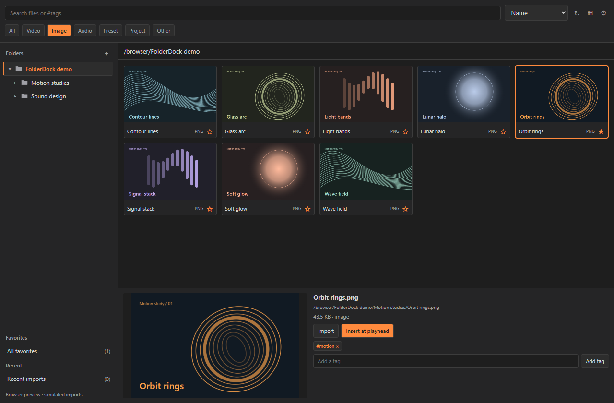
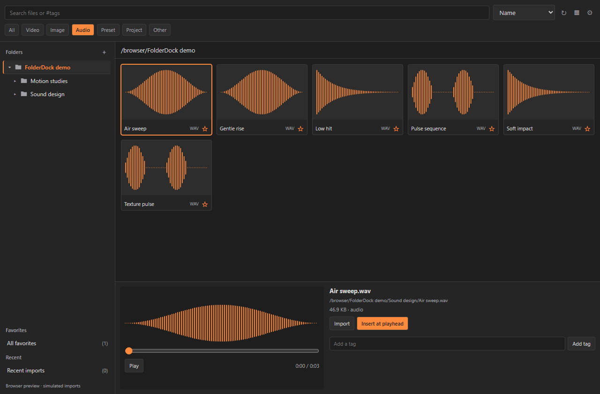

# FolderDock

**Your asset folders, inside Premiere Pro and After Effects.**

FolderDock is a free, open-source CEP panel for browsing local media, finding presets, previewing files, and placing assets at the playhead. Bring your own library. No account, subscription, telemetry, or cloud service.

[Download v1.0.2 preview](https://github.com/34rns/FolderDock/releases/download/v1.0.2/FolderDock-1.0.2-preview.zip) · [Installation guide](extension/README.md) · [Release notes](CHANGELOG.md) · [Report an issue](https://github.com/34rns/FolderDock/issues)



## Built around your folders

- **Browse recursively.** Select a parent folder to see its assets, or expand the tree to focus on a subfolder.
- **Find files quickly.** Search names and tags, filter by type, sort the library, and keep favorites and recent imports close.
- **Preview before placing.** View images, silent video previews, and matching sidecar thumbnails, including mirrored preview folders.
- **Listen when you choose.** Audio stays silent while browsing. Select a file for a full-file waveform, playback controls, and seeking.
- **Place without disturbing existing work.** Media placement uses empty, unlocked Premiere tracks or new After Effects layers. FFX presets apply to new composition-sized solids.
- **Keep processing local.** Optional FFmpeg support handles additional preview formats and large audio. It is never downloaded automatically.



Screenshots show the actual browser preview with generated demo media and simulated Adobe imports. Demo media is not bundled with the extension.

## Designed to stay light

Version 1.0.2 waits for you to choose a folder before scanning or watching files. Directory reads are asynchronous, the grid renders only nearby rows, and preview queues discard work that is no longer visible. Hidden panels pause media and folder watching. Optional FFmpeg work runs one job at a time with one thread per decoding, filtering, and encoding stage.

The browser stress check handled **20,000 assets with 32–36 rendered cards**. A local 1,029-asset scan completed in **2.15 seconds**, with a maximum **11 ms delay beyond a 10 ms timer interval**. These are local component measurements, not Adobe startup benchmarks. See [performance notes and limits](docs/performance.md).

## Install

1. Download and extract the [v1.0.2 preview ZIP](https://github.com/34rns/FolderDock/releases/download/v1.0.2/FolderDock-1.0.2-preview.zip).
2. Close Premiere Pro and After Effects. Open PowerShell in the extracted `FolderDock` folder and run:

   ```powershell
   powershell -NoProfile -ExecutionPolicy Bypass -File .\tools\install.ps1
   ```

3. Restart Adobe and open **Window > Extensions > FolderDock**. Some versions use **Extensions (Legacy)**.
4. Add a folder with **+**, then select it to browse.

The installer backs up an existing installation and enables unsigned CEP panels for the current user. A macOS installer is included; its execution on macOS remains unverified. Read the [complete guide](extension/README.md) for paths, manual details, troubleshooting, and optional FFmpeg setup.

## Compatibility and preview status

FolderDock uses **Adobe CEP**, not UXP. It requires a host version that still supports CEP panels. The manifest declares Premiere Pro 14+ and After Effects 17+; that is a registration range, not a tested compatibility matrix.

Version 1.0.2 passes 38 automated regressions, real local FFmpeg conversions, browser interaction checks, and the large-library stress check. **Fresh testing inside Premiere Pro and After Effects is still pending.** The release is an unsigned developer preview. Follow the [Adobe acceptance checklist](extension/MANUAL-TEST.md) in a scratch project.

Premiere track creation is manual. PRFPSET files use Adobe's manual preset import command. CEP does not provide native panel-to-timeline file dragging here; use the import buttons. Text-specific FFX presets may not suit a solid layer.

## Local data and privacy

Your source assets stay untouched. Folder roots, favorites, tags, and preferences are stored in `FolderDock/library.json` under Adobe's user-data directory. Generated previews stay in `FolderDock/cache`. Copy the library file to back up your preferences. FolderDock makes no network requests and includes no media packs or FFmpeg executable.

## Development

Plain JavaScript, CSS, and ExtendScript; no framework or build step. The core test suite uses Node.js's built-in test runner.

```powershell
node --test tests/*.test.cjs
powershell -NoProfile -ExecutionPolicy Bypass -File tools/lint.ps1
```

See [Contributing](CONTRIBUTING.md) for optional browser checks, project structure, and packaging.

## License

FolderDock code is [MIT licensed](LICENSE). Bundled Adobe CSInterface and the JSON compatibility helper retain their original terms; see [third-party notices](extension/THIRD_PARTY_NOTICES.md). FolderDock is an independent project and is not affiliated with or endorsed by Adobe.

## Support

[Buy me a coffee](https://www.supportkori.com/rnsofficial)
